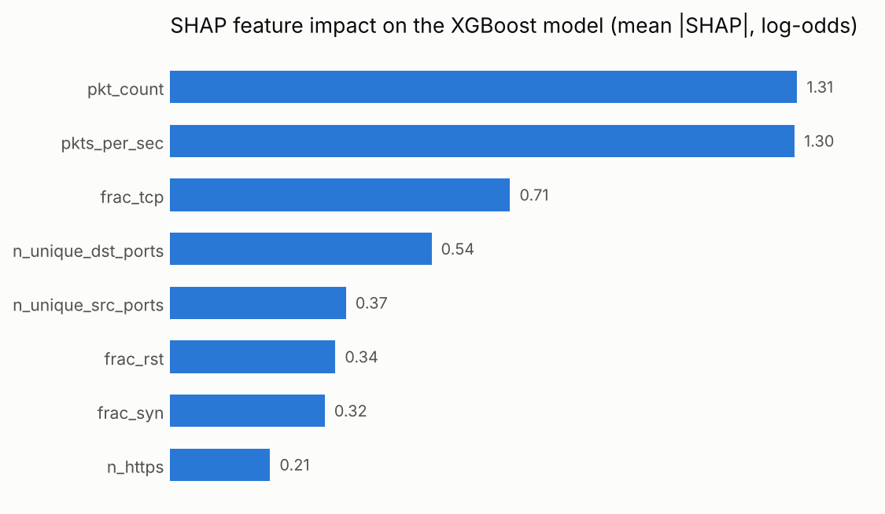
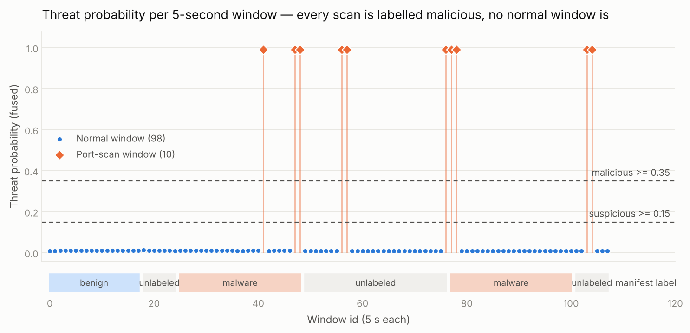
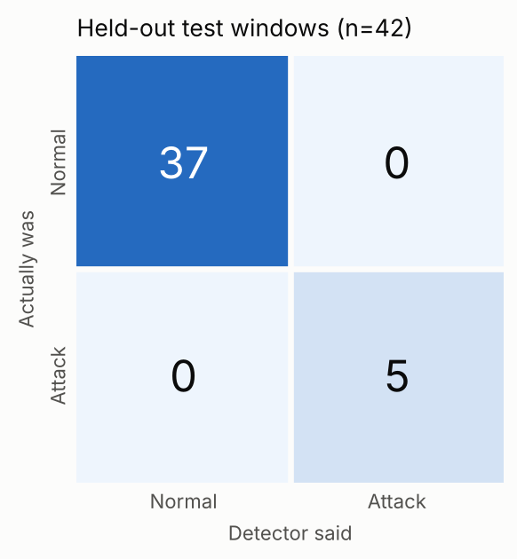

# Detector evaluation

Pipeline: XGBoost + incremental model -> probability fusion -> threshold logic, with SHAP
on the XGBoost model. All numbers are regenerated by `python3 train_detector.py`
(`../models/model_card.json`); they vary slightly between machines.

## 1. Data

* `dataset.jsonl`: 108 five-second windows, 28 features, one capture session.
  Manifest labels: {'benign': 18, 'malware': 48, 'unlabeled': 42}.
* `live_fingerprints.jsonl`: 62 windows recorded from the real live stream by
  Person 2, containing one real `nmap -T4 -p 1-1000` scan (window 7, 746 packets).

## 2. Label cleaning

The manifest marks a whole run interval as `malware`, but only
5 of those 48 windows contain a scan, and 5 `unlabeled` windows are clearly scans.
A window is treated as an attack only if its packet count exceeds 5x the busiest
benign window (76 packets, so 380). Smallest attack window: 746 packets. Largest normal
window: 76. Result: 10 attack / 98 normal in the dataset, 1 / 61 in the live sample.

The factor was 10 at first. It was lowered to 5 when the live sample arrived, because its
real scan (746 packets) sat just under the old cut-off of 760. No dataset label changed.

## 3. Results

| Evaluation | TP | FP | FN | TN | Accuracy | Precision | Recall | False-positive rate |
|---|---|---|---|---|---|---|---|---|
| fused XGBoost + incremental | 5 | 0 | 0 | 37 | 1.000 | 1.000 | 1.000 | 0.000 |
| XGBoost alone | 5 | 0 | 0 | 37 | 1.000 | 1.000 | 1.000 | 0.000 |
| incremental model alone | 5 | 0 | 0 | 37 | 1.000 | 1.000 | 1.000 | 0.000 |
| fused, trained on RAW manifest labels | 5 | 36 | 0 | 1 | 0.143 | 0.122 | 1.000 | 0.973 |
| one-class SVM, normal-only (unsupervised baseline) | 5 | 0 | 0 | 37 | 1.000 | 1.000 | 1.000 | 0.000 |
| fused, stratified 5-fold over all 108 windows | 10 | 0 | 0 | 98 | 1.000 | 1.000 | 1.000 | 0.000 |
| fused WITHOUT scan augmentation, same 5-fold | 10 | 0 | 0 | 98 | 1.000 | 1.000 | 1.000 | 0.000 |
| LIVE sample, trained on dataset only, WITHOUT augmentation | 0 | 0 | 1 | 61 | 0.984 | 0.000 | 0.000 | 0.000 |
| LIVE sample, trained on dataset only, with augmentation | 1 | 0 | 0 | 61 | 1.000 | 1.000 | 1.000 | 0.000 |

The first five rows train on the labelled runs (66 windows) and test on the 42 `unlabeled`
windows. The 5-fold rows test every dataset window once. The LIVE rows train on the
dataset only and test on the live sample, which the models never saw.

## 4. The live sample exposed a real weakness, and how it was fixed

Trained on the dataset as it was, the detector scored the real live scan
0.29: "suspicious", below the 0.35 needed to trigger a heal. XGBoost gave it
about 0.02 and the incremental model about 0.7. The cause: every scan in the dataset is
2,000 to 42,000 packets per window, so XGBoost learned "attack = huge volume", and the
live scan of 1,000 ports was only 746 packets.

Fix: **scan augmentation**. Training now adds copies of each real attack window with the
volume features scaled down to smaller packet counts and the port-count features scaled
to fewer ports, leaving the protocol mix (TCP share, SYN and RST ratios) as recorded.
Augmented rows are used for training only.

With augmentation, still trained on the dataset only, the same live scan scores
0.96 and the highest of the 61 normal live windows scores 0.008. In the 5-fold
check the lowest attack probability rose from 0.37 to 0.93, so the malicious
threshold of 0.35 is no longer a narrow pass.

Be honest about this in the report: the augmentation was designed after seeing the live
scan fail, and it is validated on exactly one live attack window.

## 5. Saved model

The model written to `models/` is trained on everything: 170 real windows
(11 attack), 407 rows after augmentation. The results above come from
models that had not seen their test windows; replaying `dataset.jsonl` or
`live_fingerprints.jsonl` through the saved model is a loop test, not an accuracy test.

## 6. SHAP feature impact (saved model)

| Feature | Mean \|SHAP\| (log-odds) |
|---|---|
| pkt_count | 1.306 |
| pkts_per_sec | 1.301 |
| frac_tcp | 0.708 |
| n_unique_dst_ports | 0.544 |
| n_unique_src_ports | 0.366 |
| frac_rst | 0.344 |
| frac_syn | 0.322 |
| n_https | 0.208 |

Volume still leads, but TCP share, destination-port count and the SYN/RST ratios now
carry real weight, which they did not before augmentation.

## 7. Limitations

* One device, one attack type (port scan), 11 real attack windows in total.
* Augmented attack windows are synthetic: scaled copies, not recorded traffic.
* Supervised models only recognise scan-like attacks; the one-class SVM row shows an
  unsupervised detector that could be added to the fusion for novel attacks.
* Attack labels come from a packet-burst rule on the same data; the manifest should mark
  only the seconds the attack tool runs.
* Normal traffic is under-sampled, and the boot sequence after a restore has never been
  seen by the models.
* The full live loop (stream -> detector -> real restore.sh) has not been run yet.
