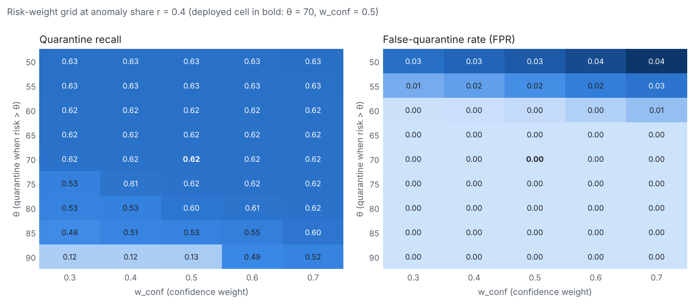

# EXP-8 (completion) — Quarantine threshold θ × risk weights

**Status**: PRELIMINARY — training attacks all come from one session (Oct 16). Measured by `experiments/run_phase2b.py`; nothing copied from the paper.

Decision = quarantine when risk > θ. risk = w_conf·conf + w_anom·anomaly + w_sev·severity·conf, w_anom + w_sev = 1 − w_conf, split by the ratio r = w_anom / (w_anom + w_sev). Deployed: θ = 70, w_conf = 0.5, r = 0.4 (0.2 / 0.3). Means over 100 grouped splits. **Descriptive only** — choosing a cell from this table would tune on test data; the Phase 4 validation sessions are for that.

## Mean quarantine recall at r = 0.4 (deployed ratio)

| θ \ w_conf | 0.3 | 0.4 | 0.5 | 0.6 | 0.7 |
|---|---|---|---|---|---|
| 50 | 0.630 | 0.630 | 0.630 | 0.632 | 0.633 |
| 55 | 0.625 | 0.626 | 0.626 | 0.627 | 0.627 |
| 60 | 0.624 | 0.625 | 0.625 | 0.625 | 0.625 |
| 65 | 0.622 | 0.624 | 0.624 | 0.625 | 0.625 |
| 70 | 0.616 | 0.619 | **0.622** | 0.623 | 0.624 |
| 75 | 0.533 | 0.607 | 0.616 | 0.620 | 0.622 |
| 80 | 0.527 | 0.530 | 0.596 | 0.611 | 0.616 |
| 85 | 0.477 | 0.512 | 0.526 | 0.547 | 0.601 |
| 90 | 0.118 | 0.118 | 0.125 | 0.492 | 0.522 |

## Mean false-quarantine rate (FPR) at r = 0.4 (deployed ratio)

| θ \ w_conf | 0.3 | 0.4 | 0.5 | 0.6 | 0.7 |
|---|---|---|---|---|---|
| 50 | 0.027 | 0.029 | 0.032 | 0.036 | 0.042 |
| 55 | 0.013 | 0.016 | 0.020 | 0.023 | 0.025 |
| 60 | 0.000 | 0.001 | 0.001 | 0.004 | 0.008 |
| 65 | 0.000 | 0.000 | 0.000 | 0.000 | 0.000 |
| 70 | 0.000 | 0.000 | **0.000** | 0.000 | 0.000 |
| 75 | 0.000 | 0.000 | 0.000 | 0.000 | 0.000 |
| 80 | 0.000 | 0.000 | 0.000 | 0.000 | 0.000 |
| 85 | 0.000 | 0.000 | 0.000 | 0.000 | 0.000 |
| 90 | 0.000 | 0.000 | 0.000 | 0.000 | 0.000 |

## Effect of the anomaly / severity ratio (θ = 70, w_conf = 0.5)

| r (anomaly share) | w_anom | w_sev | recall | FPR | F1 |
|---|---|---|---|---|---|
| 0.00 | 0.00 | 0.50 | 0.544 | 0.000 | 0.697 |
| 0.25 | 0.12 | 0.38 | 0.621 | 0.000 | 0.758 |
| 0.40 ← deployed | 0.20 | 0.30 | 0.622 | 0.000 | 0.759 |
| 0.50 | 0.25 | 0.25 | 0.622 | 0.000 | 0.759 |
| 0.75 | 0.38 | 0.12 | 0.623 | 0.003 | 0.759 |
| 1.00 | 0.50 | 0.00 | 0.630 | 0.022 | 0.757 |

Reading: with the anomaly term capped by its weight, θ above w_conf + w_anom·1 cannot be reached by anomaly alone; see EXP-4 C for the same limit at the action threshold of 30.
